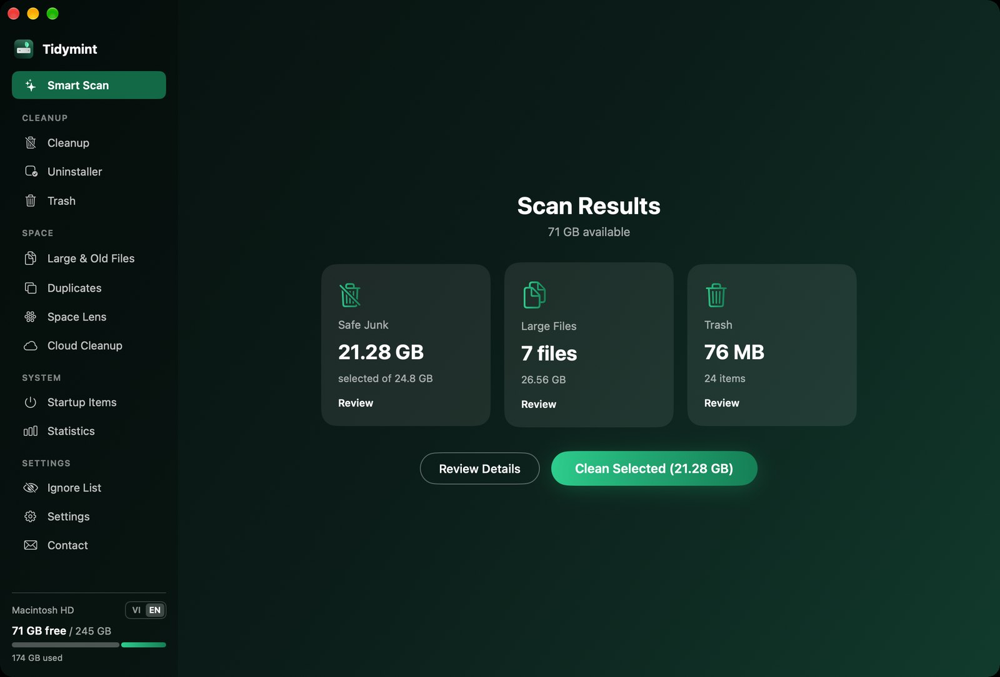
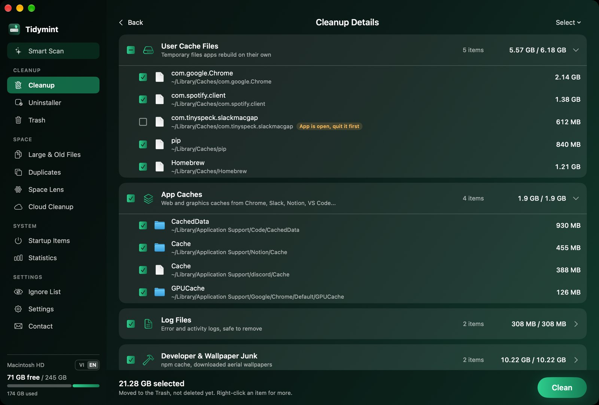
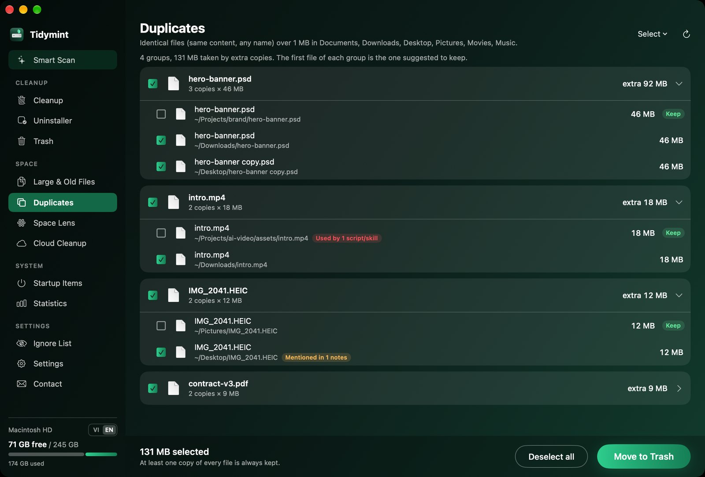
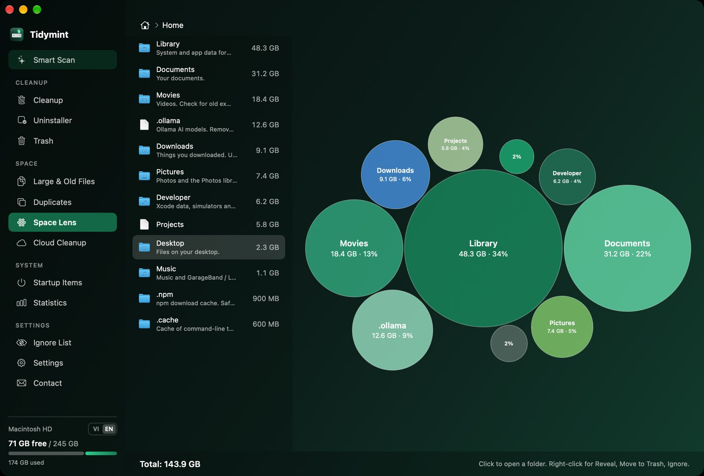
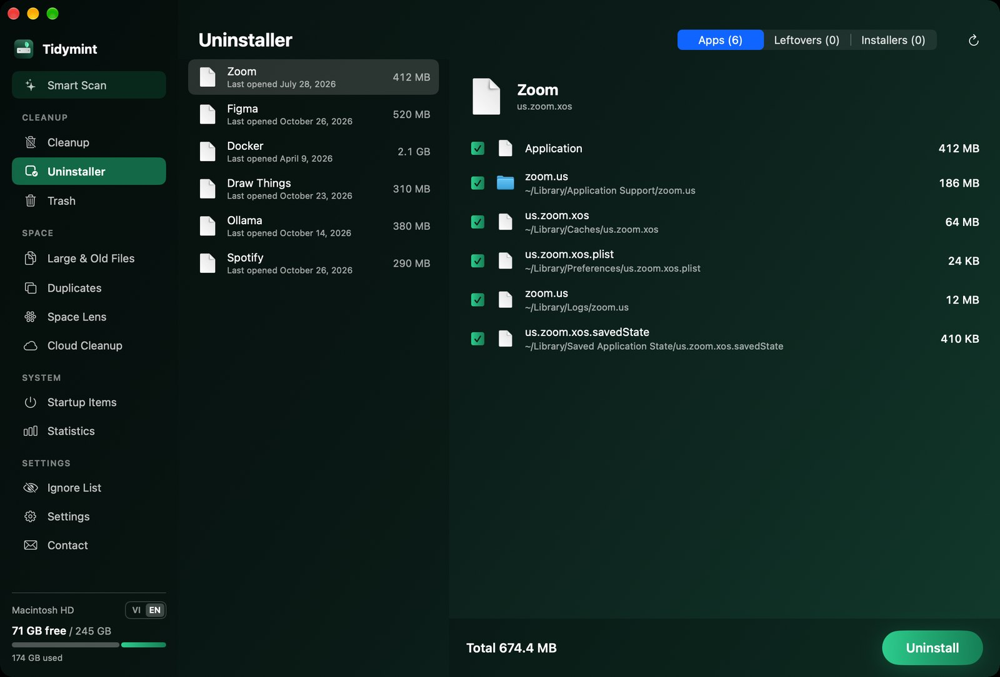
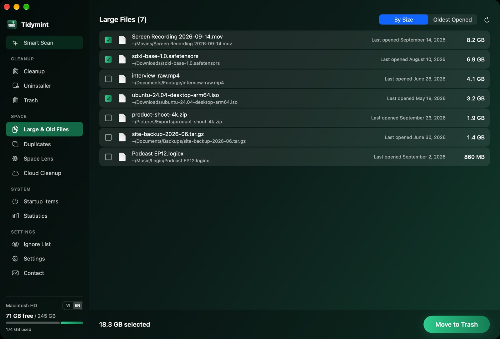

# Tidymint

**Keep your Mac in mint condition.** A free, open-source Mac cleaner, built for people who work with AI tools. A free alternative to CleanMyMac.

AI work leaves a lot behind: model files, drafts, exported images, duplicate assets, caches from browsers and editors. Tidymint finds that clutter, shows exactly what it is, and moves only what you select to the Trash.

> **Safety first.** Nothing is deleted permanently. Every action moves files to the Trash, and the Trash is only emptied when you click **Empty Trash** and confirm.



## See it in action

*Screenshots use sample data.*

### 1. One scan, then you decide
Smart Scan finds safe junk, large files and the Trash in one pass. Nothing is removed until you click **Clean**, and everything goes to the Trash first.

### 2. Full control over every item
Open **Review Details** to see each category, expand it, and tick or untick single items. Apps that are still running are flagged and left unticked.



### 3. Duplicates without the risk
Identical files are grouped (SHA-256, any file name). The best copy is marked **Keep**, and one click selects every extra copy. Before deleting, the app checks your project folders: a file still used by a script or skill is flagged in red and unticked for you.



### 4. See where the space went
Space Lens draws every folder as a bubble sized by real disk usage, with plain-language notes for common folders, including AI model folders like `.ollama`.



### 5. Uninstall apps completely
Removing an app also finds its caches, preferences, logs and saved state. Leftovers from apps you already deleted and old installers have their own tabs.



### 6. Large and old files, never pre-selected
Files over 100 MB, sorted by size or by when you last opened them. You pick what goes.



## Features

| Area | What it does |
|---|---|
| **Smart Scan** | One click to find safe junk, large files and the Trash size |
| **Cleanup** | User caches, app caches (Chrome, Slack, Notion, VS Code...), logs, npm cache, downloaded aerial wallpapers, old Downloads, `_tmp` / `_to_delete` drafts in your project folders |
| **Uninstaller** | Removes an app together with its leftovers; finds leftovers of apps already removed and old installers |
| **Large & Old Files** | Files over 100 MB in your personal folders, never pre-selected |
| **Duplicates** | Finds identical files (SHA-256), keeps one copy, and before deleting can check whether a script or skill in your project folders still uses them |
| **Space Lens** | Bubble map of what takes up space, with plain-language notes for common folders (AI model folders included) |
| **Cloud Cleanup** | Shows how much of iCloud Drive, Google Drive, Dropbox... is stored locally |
| **Startup Items** | Lists background helpers that start with your Mac; flags ones left by removed apps |
| **Statistics** | Space freed over time and a full activity log |
| **Menu bar** | A hard-drive indicator with free space inside, plus disk, RAM and Trash at a glance |
| **Contact** | Send feedback or bug reports from inside the app |

Also: English and Vietnamese, five colour themes (Mint, Night Sky, Burgundy, Golden Gate, Pride) with a matching app icon, an Ignore list, and alerts when disk space or memory runs low.

## Install

### Build from source (recommended)

Requirements: macOS 14 or later, Xcode Command Line Tools (`xcode-select --install`).

```bash
git clone https://github.com/HaiTrung-Workspace/tidymint.git
cd tidymint
./build.sh --install
```

### First launch

1. Open **Tidymint** from Applications.
2. Grant **Full Disk Access** in System Settings > Privacy & Security > Full Disk Access, so the app can measure every folder. Without it, some folders show as empty.
3. Optional: in **Settings**, add your **project folders** (code, AI workspaces). Drafts are found there, duplicates there are never pre-selected, and links are checked there before deleting.

## What it never touches

Photos libraries, Mail, keychains and passwords, cloud storage roots, iCloud Drive internals, Apple system caches, browser profiles for antidetect tools, and anything on your Ignore list. You can add more protected keywords:

```bash
defaults write com.haitrung.diskcleanup protectedKeywords -array "my-profile-folder"
```

## Where data is stored

- Settings: `~/Library/Preferences/com.haitrung.diskcleanup.plist`
- Activity log: `~/Library/Application Support/Tidymint/activity.log`

The app works offline. It sends nothing anywhere unless you choose to send feedback or join the newsletter. See [PRIVACY.md](PRIVACY.md).

## Feedback

Use **Contact** inside the app (an email address is required so you can get a reply), or open an issue on GitHub.

Self-hosting the collector: `backend/Code.gs` is a Google Apps Script that appends submissions to a Google Sheet. Deploy it as a web app and put its URL in `Backend.endpoint`.

## License

MIT. See [LICENSE](LICENSE). The software is provided "as is", without warranty of any kind. Review what you select before cleaning.

---

## Tiếng Việt

**Tidymint** là app dọn ổ đĩa miễn phí, thay thế CleanMyMac mà không cần crack, mã nguồn mở cho macOS, dành cho người làm việc với AI. App chỉ chuyển file vào Thùng rác, không xoá vĩnh viễn. Cài đặt: chạy `./build.sh --install`, cấp quyền **Truy cập toàn bộ ổ đĩa**, rồi thêm **thư mục dự án** trong phần Cài đặt. Giao diện có tiếng Việt, tự chọn theo ngôn ngữ của máy.
